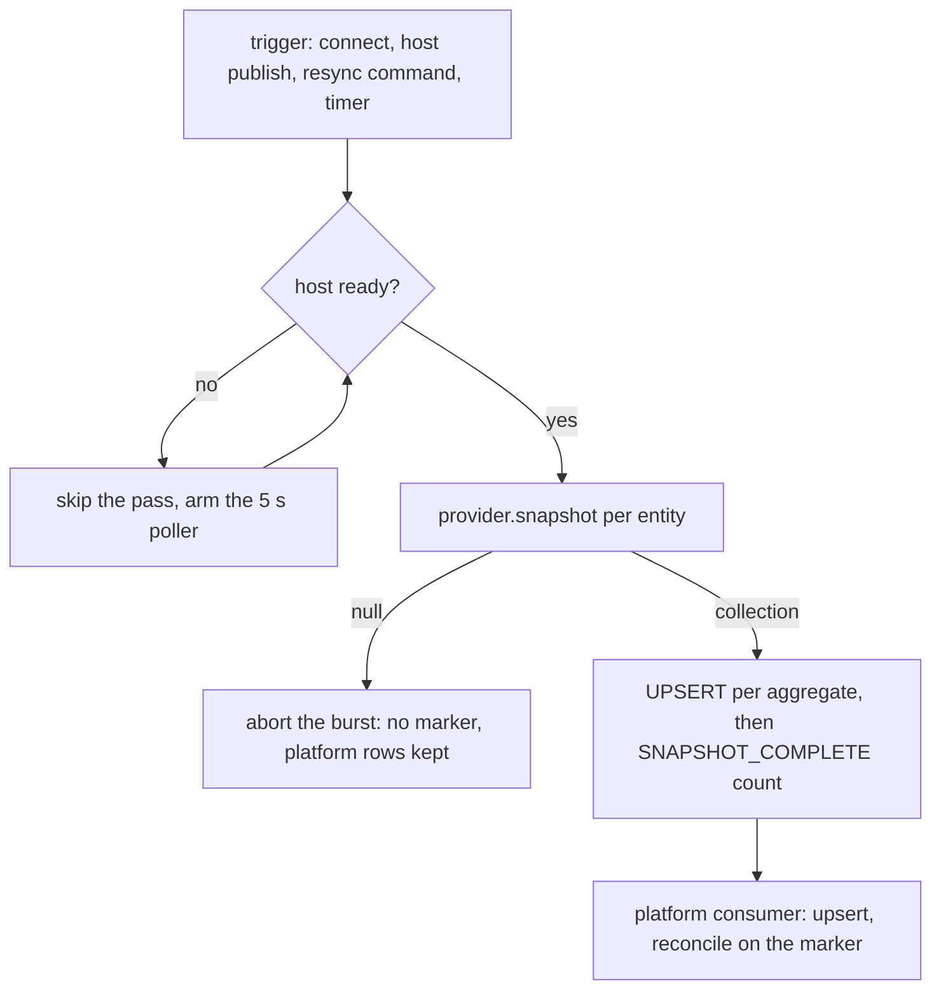

# Game-data sync (gd-sync) — static catalog snapshots + host-readiness gate

> Owner: @n1rmata

Spec for the `:nx-gs-gd-sync-core` module. Covers what the module publishes and how, the
host-readiness contract added in gd-sync `0.11.0` / api `0.83.0`, and the item-skill, soul-crystal and reduced-consumption stat contract (§8).

Cross-repo: the host integration (Tier-2 providers + readiness signal), `nx-gamedata` (platform consumer of
the `gd` stream: `nx-gamedata/docs/specs/015-l2-gamedata-storage-v3-design.md` §29,
`nx-gamedata/docs/specs/025-augmentation-via-adapter.md` for option skills,
`nx-gamedata/docs/specs/014-item-variant-groups-design.md` for weapon special abilities), `nx-tenants` (the
`entityName` → topic map).

Issues: [l2nx/nx-gs-adapter#8](https://github.com/l2nx/nx-gs-adapter/issues/8) (readiness),
[l2nx/nx-platform#81](https://github.com/l2nx/nx-platform/issues/81) (item-skill type, soul crystal, §8).

## Summary

Each gd catalog the host loads (items, npcs, skills, recipes, armor sets, soul crystals, classes, instances, the
augmentation and fishing catalogs, gear score, experience levels) has one Tier-2 provider SPI. The gd-sync module
pulls a full snapshot from every registered provider and publishes it as one burst per entity: an `UPSERT` record per
aggregate, then a `SNAPSHOT_COMPLETE` marker with the count (§1). The platform consumer upserts the records and, on
the marker, deletes the rows of that entity the burst did not carry (§7). Bursts run at connect, on a host
re-publish, on a platform resync command and on an optional timer, coalesced into one pass at a time (§1.3).

The failure path is the marker. A provider that is not ready returns `null`, and the burst is aborted with no marker,
so the platform keeps its previous rows (§2). A host that declares its readiness through `GameDataReadinessProvider`
is not asked for any snapshot until it is ready; a poller publishes as soon as it is (§3). An empty collection is a
real, empty catalog and wipes the entity on the platform.

The wire describes the game, not the engine: when an item or an option brings a skill, the type of that grant is the
closed `ItemSkillType` vocabulary plus the engine token beside it, one vocabulary for both (§8.1). The soul-crystal
leveling chain is the `soulcrystal` entity keyed by the crystal's item template (§8.3). A weapon's reduced soulshot
and MP consumption travel as four `Stat` keys of its item stats (§8.4).



## Problem

Static game data — item / npc / skill / recipe / armor-set / soul-crystal / class / instance
templates plus the gear-score ruleset — lives in the host's datapack and is parsed into host memory
at boot. The platform needs it as a catalog (wiki, market, gear-score tables) and cannot read the
datapack itself: file layout is per-client proprietary, and the parsed form (post-override,
post-custom) is the only truthful one.

So the adapter publishes the host's already-parsed in-memory catalogs as full snapshots on the `gd`
sync stream, and re-publishes on demand when the host reloads its datapack.

The second half of this spec fixes a boot-ordering flaw in that design: the adapter connects and
pulls a snapshot **before** the host has loaded those catalogs, which produced eight false `ERROR`
lines on every game-server boot (312 over 2026-08-01…15) and — via the gear-score singleton path —
briefly reconcile-deleted the platform's gear-score ruleset on every boot.

## 1. Module shape

`GameDataSyncModule` is a Tier-1 `AdapterModule`, discovered by adapter-core via `ServiceLoader`.
Data-driven: a static registry of `EntityDescriptor`s pairs each gd entity's Tier-2 provider SPI with
its snapshot accessor and primary-key extractor, so adding an entity is one registry line.

### 1.1 Entity registry

| entity                    | Tier-2 SPI                        | pk                                 |
| ------------------------- | --------------------------------- | ---------------------------------- |
| `itemtemplate`            | `ItemTemplateProvider`            | `template.id`                      |
| `npctemplate`             | `NpcTemplateProvider`             | `template.id`                      |
| `skill`                   | `SkillProvider`                   | `skill.id`                         |
| `recipetemplate`          | `RecipeTemplateProvider`          | `template.id`                      |
| `armorsettemplate`        | `ArmorSetTemplateProvider`        | `template.id`                      |
| `soulcrystal`             | `SoulCrystalProvider`             | `crystal.itemTemplateId`           |
| `classtemplate`           | `ClassTemplateProvider`           | `clazz.ordinal()` (`-1` when null) |
| `instance`                | `InstanceTemplateProvider`        | `template.id`                      |
| `itemoption`              | `ItemOptionProvider`              | `option.id`                        |
| `augmentationtargetgroup` | `AugmentationTargetGroupProvider` | `group.id`                         |
| `lifestone`               | `LifeStoneProvider`               | `stone.itemTemplateId`             |
| `gearscore`               | `GearScoreRulesetProvider`        | constant `0` (singleton)           |
| `experiencelevel`         | `ExperienceLevelProvider`         | `level`                            |
| `fishingbait`             | `FishingBaitProvider`             | `bait.itemTemplateId`              |
| `fishingrod`              | `FishingRodProvider`              | `rod.itemTemplateId`               |
| `fishingshot`             | `FishingShotProvider`             | `shot.itemTemplateId`              |

[done] The fishing gear entities (`fishingbait`, `fishingrod`, `fishingshot`): implemented in the adapter, not yet
released. Their DTOs are specified in [`fishing-gear-contract.md`](fishing-gear-contract.md).

Each present provider becomes an independent `EntitySync` with its own burst, `syncId` and heartbeat
`EntityStats`. A missing provider is skipped; two impls of one SPI put the module in `FAILED` (the
module never guesses which one is authoritative). No provider at all → `DISABLED`.

`gearscore` is a **singleton entity**: its SPI returns `Optional<GearScoreRuleset>`, adapted to a
0-or-1-element collection so it reuses the same burst engine.

### 1.2 Burst protocol

Per entity, keyed by `serverId` (raw 16-byte UUID, so the whole burst lands on one partition in
order):

1. one `GameDataSyncEvent{op=UPSERT, syncId, pk, payload}` record per template,
2. one terminal `GameDataSyncEvent{op=SNAPSHOT_COMPLETE, syncId, count}` marker.

`syncId` is UUIDv7 (time-ordered — the platform derives burst time from the id). Every record carries
`Message-Type=GameDataSyncEvent`. The topic of each entity comes from `ctx.getSyncTopics().getGd()`
(keyed by `entityName`); an absent topic skips that entity with a `WARN`. The platform maps every
entity to one `<tenant>.gd.sync` topic (since 2026-10-08); the consumer routes by the envelope's
`entityName`. The map is applied at `/connect`, so a host picks up a changed map on reconnect.

The platform treats `SNAPSHOT_COMPLETE` as the reconcile point: rows of that entity not seen under
the terminal `syncId` are deleted. That makes the marker the dangerous part of the protocol — see §2.

### 1.3 Triggers

| trigger                        | source                                             |
| ------------------------------ | -------------------------------------------------- |
| initial burst on `start()`     | adapter connect lifecycle                          |
| `NxGameData.publishSnapshot()` | host, e.g. after an in-game datapack reload        |
| `GdResyncCommand`              | platform, remote RPC over the commands topic       |
| periodic resync                | `l2nx.gd-sync.resync-interval-hours` (default off) |

All four funnel into `runAllSnapshots`, which coalesces concurrent triggers into a single in-flight
pass: every caller arms `rerunRequested` **before** contending for the running flag, so no trigger is
lost and no two passes run at once. All of them run on `ctx.io()` — never on the connect or game
thread.

### 1.4 Config

`GameDataSyncConfig`, file-first source chain (`l2nx.properties`, then system properties), read once
at module start:

- `l2nx.gd-sync.resync-interval-hours` — `0`/absent disables the scheduler; any positive value is
  clamped up to a minimum of `1` hour.

Readiness timings (§3.6) are deliberately **not** configurable — see the decision note there.

### 1.5 Status

`currentStatus()` reports module state plus one `EntityStats` per active entity: `HEALTHY` once a
burst completed, `DEGRADED` otherwise; `lastSyncEpochMs` stays `0` until the first complete burst, so
the platform can tell "never synced" from "was synced, now degraded".

## 2. Snapshot contract: `null` ≠ empty

The provider contract distinguishes two returns, and the distinction is load-bearing:

- **empty collection** — "this catalog is legitimately empty". Legal. Emits `SNAPSHOT_COMPLETE`
  with `count=0`. Its reconcile pass deletes all rows of that entity for that server on the platform
  (§7), so a real disappearance of an entity needs no manual step.
- **`null`** — "no snapshot to give". The publisher aborts the burst: no marker is emitted, nothing
  is reconciled, the previous platform state survives untouched.

Coercing `null` into an empty collection would therefore wipe the whole catalog. This is why the
publisher refuses, and why refusing is correct. What was missing until §3 is that `null` had only one
reading — "the provider broke its contract" — while in practice it also meant "the host has not
loaded its catalogs yet", which is a normal, expected state on every boot.

## 3. Host readiness

### 3.1 Symptom

Every game-server boot logged eight `ERROR` lines, one per entity:

```
ERROR a.l.g.g.s.GameDataSnapshotPublisher - [L2NX] gd-sync provider for entity 'itemtemplate'
      returned null snapshot (contract violation) — burst aborted, no SNAPSHOT_COMPLETE emitted
```

~39s later a second burst published all eight successfully. No data loss — but 16 lines/day/server of
permanently false `ERROR`, which trains operators to ignore `ERROR` from this component and will mask
the case where the retry does _not_ recover. Reported independently by an operator reading a boot
log: real attention spent on a non-event.

### 3.2 Root cause

The adapter starts — and gd-sync fires its initial burst — during host boot, **before** the host has
parsed its item / npc / skill / spawn catalogs. Pulling a snapshot then would force-load those
parsers off the host boot thread, out of order (e.g. spawn parsing ahead of zone / territory init),
risking a half-initialized load or a poisoned singleton. So the host's Tier-2 providers deliberately
return `null` until boot finishes — exactly as documented in the host's game-data module.

In other words the adapter logged `ERROR` for behaviour it itself required. `null` was carrying two
distinct states with no way to express the first:

- "provider is not ready yet" — expected, transient, recovers on the next burst,
- "provider is ready and returned null anyway" — a genuine contract violation.

### 3.3 The gear-score hole (not in the original report)

`gearscore` was reported as "the only entity that succeeds on the first burst". It does not succeed —
it publishes an **empty** snapshot. Its SPI returns `Optional<GearScoreRuleset>`, which physically
cannot express "not ready" separately from "gear score is disabled": the host returns
`Optional.empty()` while unready, the descriptor maps it to an empty collection, and the publisher
emits a perfectly legal `SNAPSHOT_COMPLETE count=0`.

The platform then reconcile-deletes `gd_gearscore_rulesets` for that server and re-creates it ~39s
later when the real burst lands. That is precisely the failure the `null` guard exists to prevent,
leaking through the singleton path — a recurring data hole on every boot, not just log noise. It is
the reason this fix is a readiness contract rather than a log-severity change.

### 3.4 Design — `GameDataReadinessProvider`

New optional Tier-2 SPI in `nx-gs-adapter-api`:

```java
package app.l2nx.gs.adapter.api.spi.provider;

public interface GameDataReadinessProvider {
    boolean ready();
}
```

- Resolved by gd-sync via `ServiceLoader` alongside the entity descriptors.
- **No implementation registered → the host is always ready.** Every existing host keeps today's
  behaviour; the change is purely additive on the wire and on the classpath.
- Two implementations → module `FAILED`, consistent with how duplicate entity SPIs are handled.
- Javadoc contract: `ready()` MUST be cheap, non-blocking, and callable from any thread (the adapter
  polls it from its own scheduler thread); it returns `false` while the host's game-data catalogs are
  still loading.

Module-level, not per-entity: gd catalogs come from one datapack load, and a per-entity gate would
mean nine SPI changes and nine host overrides for a signal that flips once.

### 3.5 Pass-level gate

`runAllSnapshots` checks readiness **once per pass, before the first `snapshot()` call**. Not ready →
the whole pass is skipped, providers are not touched at all, and the fallback poll (§3.6) is
(re-)armed — which also covers a host that goes unready again for a datapack reload after a
successful pass. Ready → the pass cancels the poll before publishing, so whichever path opens the
gate first makes the other redundant; this is what stops a boot from publishing the whole catalog
twice.

The same guard also drops a pass whose module is no longer `ACTIVE`, or whose `ConnectContext` is not
the current one: an `io()` task queued before a reconnect must not publish against the serverId and
topic map of the connection that replaced it.

Skipping at pass level (rather than per entity) is what closes §3.3: `gearscore` never gets the
chance to emit `count=0`, because its provider is not consulted while the host is unready. It also
preserves the boot-ordering guarantee the host wants — an unready pass triggers zero parser
force-loads.

Consequences for the other triggers:

- `start()` on a ready host — initial burst exactly as before.
- `start()` on an unready host — one `INFO` (`deferring initial snapshot`) and the poller (§3.6)
  is armed. No `ERROR`, no `WARN`.
- `GdResyncCommand` on an unready host — replies `CommandResult.unavailable("game data not ready")`
  instead of acking with `acceptedEntities` and then publishing nothing. The platform learns the
  reason instead of waiting for a snapshot that was never scheduled.
- Host-driven `publishSnapshot()` on an unready host — no-op pass, same as above.

### 3.6 Readiness poller

The module keeps a single lazily-created daemon scheduler (`nx-gd-sync-scheduler`) that now serves
both the periodic resync and readiness polling — no second thread is introduced.

- Armed whenever a pass finds the host unready — at `start()`, and again later if the host goes
  unready after having been ready. Arming is idempotent: one poll handle at a time.
- Fixed **5s** re-check. The check is one boolean call; a backoff would be extra state for no gain.
- Ready → dispatch a snapshot pass; that pass cancels the poll (§3.5), so the poller does not
  disarm itself.
- Scheduler lifecycle is guarded by one lock, and a shutdown latches: `start()` runs on the adapter's
  connect thread while `stop()` runs on the host's, so a late scheduling attempt must not resurrect a
  daemon that would outlive the connection.
- Still unready after **15 min** → exactly one `ERROR` (`host game data still not ready after 15m —
gd catalogs will not sync until the host reports ready`), then keep polling silently. A host that
  finishes booting on minute 20 still publishes.

The host's own `publishSnapshot()` call at end-of-boot stays the fast path; the poller is the
fallback that makes gd-sync self-sufficient against a host that never calls it.

**Decision — the timings are constants, not config keys.** Deliberate: fewer knobs on a module whose
only existing knob is the resync interval. Accepted cost — a host whose boot exceeds 15 min gets one
false `ERROR` per boot (down from eight). If such a host appears, promote both values to
`l2nx.gd-sync.*` keys then.

### 3.7 `null` reclassification (defence in depth)

The gate removes `null` for a host that implements the readiness SPI. `null` can still arrive from a
host that does not — including the host itself, in the window between the gd-sync release and
the host wiring its provider. So the publisher's classification changes:

- Per entity, per connection, the module tracks when `null` was first observed.
- Within 15 min of that first `null` → `WARN` ("provider not ready yet, burst deferred").
- After it → one `ERROR`, then silence for that entity.
- Any successful burst resets the tracker.

Net effect: the boot noise disappears at the gd-sync release, **before** any host change, while a
provider that is genuinely broken still surfaces as `ERROR`.

The classification is a small pure state object (input: entity, now, first-null timestamp → output:
severity), so tests assert the decision rather than scraping log output.

### 3.8 Host side (the host)

- New host `GameDataReadinessProvider` returning the host's ready flag, plus its
  `META-INF/services` entry.
- The nine existing providers are unchanged: their `null` / `Optional.empty()` guards stay as
  defence in depth and keep the host compatible with an older adapter.
- The host game-data module's `markReady()` keeps calling `NxGameData.publishSnapshot()` — now the fast path
  rather than the only path.

After the gate is live, `Optional.empty()` from the gear-score provider means only what it should:
gear score is disabled on this server, and deleting the ruleset row is the correct outcome.

## 4. Requirements

**Must:**

- [done] R1. gd-sync MUST NOT pull any provider snapshot while the host reports itself not ready.
- [done] R2. A host with no `GameDataReadinessProvider` on the classpath MUST behave exactly as
  before this change (always ready).
- [done] R3. The `gearscore` singleton MUST NOT emit `SNAPSHOT_COMPLETE count=0` as a result of host
  unreadiness. (`count=0` when gear score is genuinely disabled stays legal.)
- [done] R4. A boot of a readiness-aware host MUST produce zero `ERROR` and zero `WARN` from gd-sync.
- [done] R5. gd-sync MUST publish the first full snapshot on its own once the host becomes ready,
  without depending on the host calling `publishSnapshot()`.
- [done] R6. A host that is still not ready 15 min after connect MUST produce exactly one `ERROR`,
  and MUST still publish if it becomes ready later.
- [done] R7. `GdResyncCommand` received while the host is not ready MUST be answered `UNAVAILABLE`,
  not acked as accepted.

**Should:**

- [done] R8. A `null` snapshot from a host without the readiness SPI SHOULD be reported as `WARN` for
  the first 15 min after the first occurrence, and escalate to a single `ERROR` afterwards.

**Non-goals:**

- Making the readiness timings operator-configurable (§3.6).
- Per-entity readiness granularity.
- Any change to the `gd` wire shape, the burst protocol, or `ModuleStatus` / heartbeat payloads.

## 5. Tests (`nx-gs-gd-sync-core`)

- `runAllSnapshots` performs no provider call and publishes nothing while readiness is `false`
  — asserted per entity **and** for the `gearscore` singleton (no `count=0` marker).
- A ready host bursts exactly as today (regression against the pre-change behaviour).
- No readiness provider registered → always ready.
- Two readiness providers → `STATE_FAILED`.
- The poller publishes once readiness flips, then stops — driven synchronously, no sleeps.
- A boot publishes the catalog **once**: with the poll armed, the host's own publish disarms it, and
  a following poll tick adds nothing.
- A host that goes unready after a successful pass re-arms the poll and publishes nothing.
- Deadline escalation fires exactly once and does not stop the poller.
- `GdResyncCommand` while unready → `UNAVAILABLE`.
- `null`-severity decision table (`WARN` inside the window, single `ERROR` past it, reset on a
  successful burst), asserted per entity: one entity escalating must not escalate another.

Readiness providers are injected explicitly in tests rather than discovered — `ServiceLoader` cannot
express "none registered" or "two registered" on a classpath shared by the whole test module.

## 6. Rollout

Ordering is forced by Maven Central propagation (~15-30 min) and the host build:

1. `api/v0.83.0` — additive: new `GameDataReadinessProvider` interface only.
2. `gd-sync/v0.11.0` — gate + poller + `null` reclassification. **The boot noise is gone at this
   step**, via §3.7, before the host knows anything about readiness.
3. the host — bump api + gd-sync deps, register the host's GameDataReadinessProvider. Takes effect
   at the next game-server restart; from then on the unready window produces no log lines at all and
   the gear-score ruleset stops being deleted-and-recreated on boot.

No step is breaking, and steps 2 and 3 are independently useful — an interrupted rollout leaves a
working system.

## 7. Platform ownership canon (single topic and consumer guarantees live; renames and payload changes planned)

Agreed 2026-10-03. The platform-side design (table ownership, readers, rollout checklist) lives in
`nx-gamedata/docs/specs/015-l2-gamedata-storage-v3-design.md` §29; this section records only what
changes on the adapter side.

**Principle.** The adapter is the source of truth for game data: it publishes what the host engine
actually loaded (hardcoded rules, custom logic, overrides), which a datapack parse cannot reproduce.
Platform-side parsing is reserved for what the adapter cannot derive (client-patch data,
presentation). Each platform table has exactly one writer; the gd stream owns the core tables and
nothing else writes their rows.

**Entity renames.** The `template` suffix is kept only where an entity has instances (item, npc,
skill):

| today                                                 | target                                                                           |
| ----------------------------------------------------- | -------------------------------------------------------------------------------- |
| `classtemplate` / `ClassTemplateProvider`             | `class` / `CharacterClassDefinition…` (`CharacterClass` is the class token enum) |
| `recipetemplate` / `RecipeTemplateProvider`           | `recipe` / `Recipe…`                                                             |
| `armorsettemplate` / `ArmorSetTemplateProvider`       | `armorset` / `ArmorSet…`                                                         |
| `soulcrystaltemplate` / `SoulCrystalTemplateProvider` | `soulcrystal` / `SoulCrystalProvider` ([done] §8.3)                              |

**One topic for all entities — done 2026-10-08.** The platform maps every entity to a single
`<tenant>.gd.sync` topic instead of one topic per entity (§1.2); the switch needed no adapter
release and the wire is unchanged. The `entityName` renames above still ride an adapter release
(the descriptor sets the value, and the topic map is keyed by it). A DTO/SPI rename is one breaking api release that
removes the old name in the same release, with no `@Deprecated` copy (root `CLAUDE.md`, «Breaking wire changes»).
`api/v0.101.0` for the `skill` record shipped that way. `soulcrystal` goes further (§8.6): the platform keeps no
straddle either, neither a second routed `entityName` nor a legacy reader. How the remaining renames roll out is
decided when each is taken.

**Payload changes.**

- `instance`: carries the host's full instance template — level window, party size, duration,
  reenter rules and children (reenter schedules, entry requirements, instance npcs) — not only
  `id` + `name`.
- `npctemplate`: one spawn row per host spawn definition with its real count (today a definition
  of count N is emitted as N rows of count N); per-npc count/respawn overrides honoured;
  `globalAggro` emitted.
- `itemtemplate`: `material` must not collapse distinct host materials into one token.
- `itemtemplate` keeps its full payload (stats, skills): the platform will start consuming it as data moves
  from platform-side parsing to the gd stream ([l2nx/nx-gamedata#65](https://github.com/l2nx/nx-gamedata/issues/65)).
  Its skill references carry the canonical `ItemSkillType` from §8 on.
- `skill` becomes the sole source of the platform skill catalog (design: `nx-gamedata/docs/specs/024-skills-via-adapter.md`,
  2026-10-11). Shipped as api 0.101.0, a breaking release (types move to sub-packages, fields are renamed or retyped,
  no deprecated leftovers; producers and consumers upgrade together). The wire shape and the vocabulary tables live in
  [`skill-contract.md`](skill-contract.md), which is the living contract and is not duplicated here. In short:
  - every vocabulary value is a canonical/raw pair: an api enum under the plain name, the engine token under
    `<name>Raw`; a canonical value is `null` unless the mapping is exact (rules N1-N10);
  - the class-only `classes` list is replaced by `learns`: every skill tree, not only the class tree, as
    `(treeKind, clazz?)` entries with prerequisites, races, residences, social class and costs;
  - use conditions are a tree (`SkillConditionNode`: `logic`, `type`, `params`, `negated`, `children`) per level,
    plus per-effect and per-stat-modifier condition trees;
  - effects carry a canonical `type`/`scope`/`params` and a numeric `value` (`valueRaw` when the engine holds a
    formula), with `derived = true` for effects the host synthesizes; stat modifiers carry canonical `stat` and
    `operation` (`_RES` stats are oriented "higher = more resistant");
  - enchanting is `(route, level)` with the enchanted level as a whole `SkillLevel` in `SkillEnchantRoute.node`, and
    chances as a map of character level to chance;
  - `effectCategory` on the aggregate, computed by the same host function as runtime character effects;
  - presentation the engine loads (names, descriptions, icons per level and enchant, per language);
  - values are server-effective (balance applied), not datapack numbers.
- Gear score: per-item effective values and the full ruleset — direction recorded in
  `nx-gamedata/docs/specs/009-gear-score-design.md` §3.5, not scheduled.

**Consumer guarantees** (platform side, protocol unchanged; live since 2026-10-08): a burst whose
persisted row count does not match `SNAPSHOT_COMPLETE.count` is not reconciled; `count=0` deletes all rows of the
entity for that server; infrastructure write failures are retried, not acknowledged. The
gd topic is kept for 48 h.

## 8. Item skills, soul crystals, reduced consumption stats ([done] api 0.139.0, gd-sync 0.18.0)

The design was approved on 2026-11-26 under [l2nx/nx-platform#81](https://github.com/l2nx/nx-platform/issues/81)
(weapon special abilities on the platform). Its adapter part is this section; the catalog of weapon special
abilities itself does not go through the adapter (Decisions). A weapon special ability may also change weapon
properties; the reduced shot and MP consumption among them get `Stat` tokens (§8.4).

### 8.1 `ItemSkillType` (`domain.item`, new)

When a skill that an item or an item option brings is in effect or is cast. One closed vocabulary for both (`ItemSkillRef.type`
and `ItemOptionSkill.type`), valid for HighFive and Essence. A constant without a prefix is a grant: the skill is learned
and held while its condition lasts (active or passive is the skill's own `operateType`). A constant with `ON_` is a
one-time cast on that event.

| constant                        | meaning                                                                                                        | `chancePercent` | `minEnchantLevel` |
| ------------------------------- | -------------------------------------------------------------------------------------------------------------- | --------------- | ----------------- |
| `EQUIPPED`                      | held while the item is equipped                                                                                | `null`          | `null`            |
| `EQUIPPED_ENCHANT`              | held while the item is equipped at an enchant level of at least `minEnchantLevel`                              | `null`          | required          |
| `EQUIPPED_BLESSED`              | held while the item is equipped and blessed                                                                    | `null`          | `null`            |
| `ON_EQUIP`                      | cast once when the item is equipped                                                                            | `null`          | `null`            |
| `ON_UNEQUIP`                    | cast once when the item is unequipped                                                                          | `null`          | `null`            |
| `ON_USE`                        | cast when the item is used                                                                                     | `null`          | `null`            |
| `ON_PHYSICAL_HIT`               | cast on a non-critical normal-attack hit and on every physical skill the owner casts, once per affected target | required        | `null`            |
| `ON_NORMAL_ATTACK_CRITICAL_HIT` | cast on a critical normal-attack hit; a critical hit of a skill does not fire it                               | required        | `null`            |
| `ON_MAGIC_SKILL_CAST`           | cast when a magic skill of the owner lands on a target, once per affected target                               | required        | `null`            |

On a normal attack `ON_PHYSICAL_HIT` and `ON_NORMAL_ATTACK_CRITICAL_HIT` exclude each other: a hit fires one or the
other. The pairing columns are the rule S2 of the platform design; the builders enforce it for a known constant (§8.2).
A consumer reads a constant it does not know as `null`, and `typeRaw` still carries the engine token.

### 8.2 `ItemSkillRef` and `ItemOptionSkill`

`ItemSkillRef` (`kafka.sync.gd.itemtemplate`, a skill of an item template), Java 8 final class with a builder:

| field             | type            | null     | semantics                                                                                      |
| ----------------- | --------------- | -------- | ---------------------------------------------------------------------------------------------- |
| `id`              | `int`           | non-null | skill id                                                                                       |
| `level`           | `int`           | non-null | skill level                                                                                    |
| `type`            | `ItemSkillType` | nullable | canonical type (§8.1); `null` when the engine token has no exact meaning in the vocabulary     |
| `typeRaw`         | `String`        | non-null | engine token the type was mapped from; never blank                                             |
| `minEnchantLevel` | `Integer`       | nullable | lowest enchant level at which the skill is held; set exactly when `type` is `EQUIPPED_ENCHANT` |
| `chancePercent`   | `Integer`       | nullable | cast chance, `[0, 100]`; set exactly when `type` is one of the three chance events of §8.1     |

`type` was an open `String` of engine tokens before this release; those tokens now go to `typeRaw`.

`ItemOptionSkill` (`kafka.sync.gd.itemoption`): `trigger` (`ItemOptionTrigger`) is replaced by `type`
(`ItemSkillType`, nullable) + `typeRaw` (`String`, non-null, never empty); `skillId`, `skillLevel`, `chancePercent`
are unchanged. `ItemOptionTrigger` is removed. The option fields and their rules are in
[`augmentation-contract.md`](augmentation-contract.md) §3.2.

Validation, the same split as `ItemOptionSkill` today: the constructor checks only what a consumer must still accept
(`typeRaw` non-empty, the chance range), so a `type` unknown to the consumer reads as `null` without rejecting the
aggregate; the builder also checks the pairing of §8.1 when `type` is set. A host builds through the builder, so a
grant with a chance, or an `EQUIPPED_ENCHANT` without a threshold, never reaches the wire and never makes the platform
reject the whole snapshot step of the entity.

### 8.3 `SoulCrystal` and `SoulCrystalProvider`

`SoulCrystal` (`kafka.sync.gd.soulcrystal`, was `kafka.sync.gd.soulcrystaltemplate.SoulCrystalTemplate`): one node of the
soul-crystal leveling chain. The crystal itself is an item; this is the growth data of that item template, so the entity
is reference data without the `Template` suffix. Java 8 final class with a builder:

| field                      | type      | null     | semantics                                                                    |
| -------------------------- | --------- | -------- | ---------------------------------------------------------------------------- |
| `itemTemplateId`           | `int`     | non-null | item template of the crystal; the pk (was `id`)                              |
| `level`                    | `Integer` | nullable | stage of the crystal in its chain; `null` when the build has no stage number |
| `nextItemTemplateId`       | `Integer` | nullable | crystal a successful level-up yields; `null` at the top of the chain         |
| `cursedNextItemTemplateId` | `Integer` | nullable | crystal a failed level-up yields; `null` when the build has none             |

`SoulCrystalProvider` (`spi.provider`, was `SoulCrystalTemplateProvider`): `entityName()` returns `soulcrystal`;
`snapshot()` follows §2, `null` until the host has loaded the data, an empty collection only when the build has no
soul crystals.

### 8.4 Reduced shot and MP consumption (`Stat`, four new constants)

A weapon property of both HighFive and Essence: when it procs on an attack, the weapon spends `count` soulshots (or MP)
instead of its normal amount, with a chance of `chance` percent. The engine keeps each as one `"chance,count"` pair
(`reduced_soulshot`, `reduced_mp_consume`). The `Stat` enum (`domain.stat`) gains four constants, appended after the
frozen ones:

| constant                    | meaning                                                        | value               |
| --------------------------- | -------------------------------------------------------------- | ------------------- |
| `REDUCED_SOULSHOT_COUNT`    | soulshots the weapon spends when the reduced consumption procs | count               |
| `REDUCED_SOULSHOT_CHANCE`   | chance of the reduced soulshot consumption                     | percent, `[0, 100]` |
| `REDUCED_MP_CONSUME_COUNT`  | MP the weapon spends when the reduced consumption procs        | count               |
| `REDUCED_MP_CONSUME_CHANCE` | chance of the reduced MP consumption                           | percent, `[0, 100]` |

They travel as keys of the item template's `ItemStats.stats` map, beside the other weapon mechanics
(`SOULSHOT_COUNT`, `MP_CONSUME`, ...): no new field and no new value shape on `ItemTemplate`. The host splits the
engine pair into the `_CHANCE` and `_COUNT` keys; both keys of a pair are present together or absent together, and a
weapon without the property carries neither (absent, never `0`). The item stat vocabulary and its source mapping are in
[`020-item-stats-unification.md`](../020-item-stats-unification.md).

### 8.5 Host guidance

- **Map exactly or not at all.** `type` is set only when the engine token means exactly the constant (rules N1-N10 of
  [`skill-contract.md`](skill-contract.md)); a build custom stays `type = null` with its token in `typeRaw`.
- **Map by what the engine does, not by the token.** The same token can mean different constants, or nothing, depending
  on how the engine treats the item that carries it:
  - a skill of equipment the engine applies while the item is worn is `EQUIPPED`;
  - a skill of a non-equipment item that the engine still places in a paperdoll slot and applies while it sits there
    is `EQUIPPED` as well;
  - `ON_USE` only when the item's use handler casts the item's skills; a usable item whose handler does something
    else does not make its skills `ON_USE`;
  - a skill the engine holds while the item merely lies in the inventory, or never casts at all, has no constant:
    `type = null` with the token in `typeRaw`;
  - an entry the engine parses but never acts on is `type = null` with its token, whatever the token's name suggests;
  - an enchant-gated skill with its threshold in the name (HighFive) or in a value (Essence) is `EQUIPPED_ENCHANT`
    with that threshold in `minEnchantLevel`.
- **`typeRaw` is the engine's own name.** Where the engine has a token, it is that token; for a build that keeps item
  skills in separate legacy fields of the item template (one field per kind of skill), it is the datapack name of that
  field. Where the engine expresses the type only by structure (for example a separate list of option skills cast on a
  critical hit, or option skills granted with no event at all), it is the name of that construct as the engine spells
  it, the same for every row of that construct. Never empty.
- **Isolate per-aggregate failures** as in [`augmentation-contract.md`](augmentation-contract.md) §5: a builder failure
  skips that item or option with a log line, never the snapshot.
- **Reduced consumption from the weapon's own data** (§8.4): the host reads the pair from the weapon template it
  loaded, including a variant template that a special ability insertion yields; a pair the engine cannot parse is
  left out with a log line, never sent half.

### 8.6 Rollout and compatibility (breaking, no straddle)

One breaking api release with `nx-gs-gd-sync-core`: the old members are removed in it, no `@Deprecated` copy. Owner
decision (2026-11-26): the platform keeps no straddle for this change either, unlike the general rule of root
`CLAUDE.md` («Breaking wire changes»): no legacy reader of the old option-skill form, no second routed `entityName`.

1. Adapter: api + gd-sync release with the migration note for external hosts in `docs/public/{en,ru}/migration.md`.
   Nothing changes at runtime until a host takes the new version.
2. Platform cutover in one pass: the `entityName` map routes `soulcrystal` instead of `soulcrystaltemplate`, and the
   consumer reads only the new form.
3. Hosts: switch to the new SPI and DTOs in one release; their data refreshes at the next game-server restart.

Accepted consequences between steps 2 and 3: a game server still on the old host sends `soulcrystaltemplate`, which the
platform skips as an unknown entity (after a reconnect the map has no topic for it, and the adapter skips the entity
with a `WARN`); its `itemoption` records lack `typeRaw` and are rejected, so the marker's `count` does not match and
nothing is reconciled. Its `itemtemplate` records with skills lack `typeRaw` as well and are rejected the same way. The
platform keeps the rows of the last good snapshot until the restart.

The four `Stat` constants of §8.4 are additive and follow the order of root `CLAUDE.md` for a new value of a closed
vocabulary: the adapter enum in step 1, the platform's reader of the keys in step 2, the host sending them in step 3.
An old host simply sends no such keys.

### 8.7 Requirements

- [done] R9. `ItemSkillType` with the nine constants of §8.1 in `domain.item`; `ItemOptionTrigger` removed.
- [done] R10. `ItemSkillRef` carries `type` (`ItemSkillType`), `typeRaw`, `minEnchantLevel`, `chancePercent` (§8.2).
- [done] R11. `ItemOptionSkill.trigger` replaced by `type` + `typeRaw` (§8.2).
- [done] R12. Builders enforce the pairing of §8.1 for a known `type`; constructors reject a null or blank `typeRaw`
  and a chance out of range only.
- [done] R13. `SoulCrystal` / `SoulCrystalProvider` in `kafka.sync.gd.soulcrystal`, `entityName` `soulcrystal`,
  pk `itemTemplateId`; `SoulCrystalTemplate` / `SoulCrystalTemplateProvider` removed (§8.3).
- [done] R14. Migration note for external hosts in `docs/public/en/migration.md` and `docs/public/ru/migration.md`
  (§8.6).
- [done] R15. `Stat` gains `REDUCED_SOULSHOT_COUNT`, `REDUCED_SOULSHOT_CHANCE`, `REDUCED_MP_CONSUME_COUNT`,
  `REDUCED_MP_CONSUME_CHANCE`, appended after the frozen constants; the `Stat` Javadoc lists them under item stats
  (§8.4).

## Decisions

- **Readiness is module-level** (§3.4): the gd catalogs come from one datapack load, so one signal; a per-entity gate
  would mean an SPI change and a host override per entity for a signal that flips once.
- **Readiness timings are constants** (§3.6): fewer knobs; a host booting longer than 15 min gets one false `ERROR`
  per boot. Rejected: `l2nx.gd-sync.*` keys now, without such a host.
- **One `ItemSkillType` for item skills and option skills** (§8.1; owner, 2026-11-26): both are skills an item brings.
  Rejected: two enums. Whether the two skill forms are one entity is the platform's open epic, not this contract.
- **Constant names** (§8.1): no prefix for a held grant, `ON_` for a one-time cast, events named in full.
  Rejected: `WHILE_EQUIPPED` (the prefix adds nothing); `ON_EQUIP` for the held grant (in Essence it is a real one-time
  event); `EQUIPPED_ENCHANT_4` (bakes the HighFive threshold in, does not fit Essence); `ON_CRIT` / `ON_CAST` /
  `ON_CRITICAL_SKILL` / `ON_MAGIC_SKILL` (do not say whose critical hit or which cast).
- **A host maps by engine behaviour, not by token** (§8.5): `type` promises the platform when the skill is in effect,
  and only the engine's handling of the item keeps that promise. Mapping by token was the first rule and was reversed
  during delivery: a token named like an equip grant that the engine parses but never applies would have shown a
  skill as held that never is. Rejected: a token-to-constant table per build.
- **`typeRaw` beside `type`, option skills included** (§8.2): the canonical/raw pair of every gd vocabulary. It
  reverses the earlier rule that the option trigger had no raw companion because it was derived from structure: with one
  vocabulary for items and options, an option of a build custom needs the same place for its token.
- **`soulcrystal` without `Template`, keyed by `itemTemplateId`** (§8.3): the crystal is an item; its growth data is
  reference data, keyed like `LifeStone`. Rejected: keeping `SoulCrystalTemplate` / `id` until a separate rename.
- **No straddle anywhere** (§8.6; owner, 2026-11-26): a short wiki error window and stale option and crystal data until
  the game servers restart are accepted. Rejected: a legacy reader of the old form on the platform; a double
  `entityName` (`soulcrystaltemplate` + `soulcrystal`) during the restarts.
- **Reduced consumption as `Stat` tokens** (§8.4; owner, 2026-11-26): four plain numbers in the existing item `stats`
  map, a count and a chance per pair, so the platform builds a weapon's effect from one map. Rejected: a typed weapon
  properties block on `ItemTemplate` (a second home for weapon numbers, against
  [`020-item-stats-unification.md`](../020-item-stats-unification.md)); one composite `"chance,count"` value (the map
  holds one number per key).
- **No weapon special ability entity in the adapter now**: the special ability's name and link come from the client
  patch, and its soul crystal from datapack recipes an engine may not load, so a host provider would repeat a tenant
  ingester's heuristics and still miss disabled recipes. Rejected: a provider for the current host.

## Out of scope

- **A `WeaponSpecialAbilityProvider`** for builds whose engine loads the insertion recipes or the special ability name:
  [l2nx/nx-gs-adapter#71](https://github.com/l2nx/nx-gs-adapter/issues/71). It ships only together with or after the
  platform consuming item-template skills, stat modifiers and weapon properties from the gd stream
  ([l2nx/nx-gamedata#65](https://github.com/l2nx/nx-gamedata/issues/65)): without them the effect of such a tenant's
  special ability would show as empty.
- **Augmentation and Essence ensoul as mechanics**: only the vocabulary of option skills changes.
- **Readiness timings as config keys and per-entity readiness** (§3.6, §4 non-goals).

## Open questions

None.

## 9. Links

- Skill record contract (api 0.101.0): [`skill-contract.md`](skill-contract.md)
- Augmentation catalog contract (api 0.116.0, `itemoption` / `lifestone` / `augmentationtargetgroup`):
  [`augmentation-contract.md`](augmentation-contract.md)
- Fishing gear contract (`fishingbait` / `fishingrod` / `fishingshot`):
  [`fishing-gear-contract.md`](fishing-gear-contract.md)
- Issue: [l2nx/nx-gs-adapter#8](https://github.com/l2nx/nx-gs-adapter/issues/8)
- `docs/specs/023-platform-sync-fixes-2026-06.md` — Fix ③, the gear-score deploy gap that first
  shipped the `gearscore` entity (`gd-sync/v0.10.0`); a version-skew incident, not a design record.
- Host side: the host's game-data module (boot-ordering gate and
  the `null` protocol it relies on).
- Platform consumer: `nx-gamedata` (gd stream ingest, reconcile-on-`SNAPSHOT_COMPLETE`).
