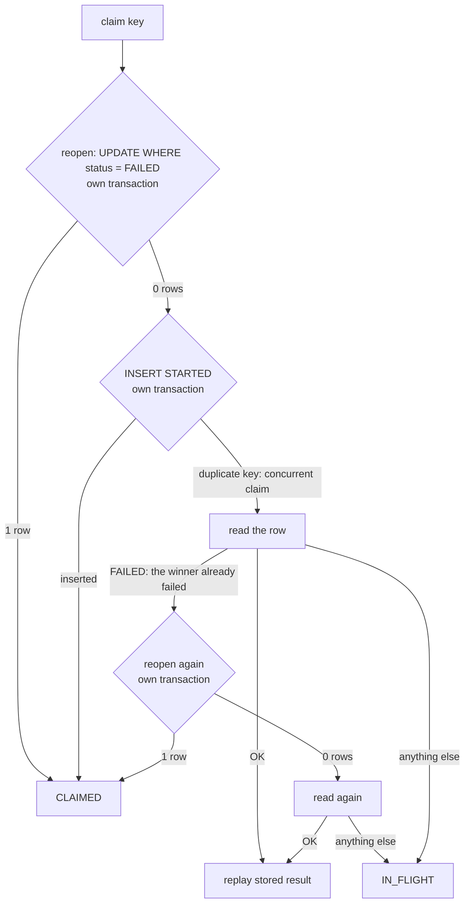

# Command receipts store

> Owner: @n1rmata

## Summary

A money-moving command handler claims a receipt keyed by the command's `idempotencyKey` before it moves anything,
then walks it through compare-and-set status transitions (`STARTED` → `CHARGED` → `OK`, or `FAILED` on a business
refusal). The host reaches the table only through `NxCommandReceipts`; the adapter owns the SQL and the dialects.
A claim of a new key inserts the row; a claim of a `FAILED` key (the routine retry after a refusal, e.g. a fee
consent) reopens it; a claim of an `OK` key replays the stored result, anything else is refused as in flight
(Decisions).

## Problem

Money-moving commands (buying from a private store, sending or accepting mail with a fee or cash-on-delivery) are
deduplicated by a claim-first ledger in the adapter-owned table `l2nx_command_receipts`: the claim commits before any
money or goods move, and when in doubt the command is refused. [`037`](037-schema-migrations.md) moved the table's DDL
into the adapter, but its SQL still lived in the host, so a host had to know an adapter table, its columns, its status
values and its engine dialect. The host must not know the adapter-owned tables at all: no SQL, no table names.

## Requirements

> Siblings: [`037-schema-migrations`](037-schema-migrations.md) (the table and the migration gate),
> [`004-jdbc-connection-source`](004-jdbc-connection-source.md) (the connection the store borrows),
> [`009-commands`](009-commands/spec.md) (the commands the receipts guard).

**Must:**

- [done] R1. `nx-gs-adapter-api` MUST define a capability `NxCommandReceipts` (`spi.capability`, value types in
  `spi.model.receipt`) whose operations cover everything a host does with receipts: claim with a replay / in-flight
  answer, lookup, the status transitions (charge, settle, fail, refund, amend the claim, mark follow-up steps done),
  clearing the mail id of goods handed back (status untouched, the host reuses mail ids), stale release, insert of an already completed receipt, pruning, and the queries boot recovery and sweeps need. Every
  status transition is a compare-and-set on the current status, as the host's own ledger did.
- [done] R2. Operations a host runs inside its own game-database transaction MUST take the host's
  `java.sql.Connection` and run on it without committing, rolling back, closing or reconfiguring it, so the receipt
  write commits or rolls back with the host's writes. Operations that report a failure by `SQLException` keep it
  checked: the host relies on it to roll back.
- [done] R3. The other operations MUST borrow from the host's `JdbcConnectionSource`, write in a transaction of their
  own and hand the connection back with the read-only and auto-commit modes it was lent with. `...OwnTx` operations
  report a database failure as a logged miss (`false`), the rest throw.
- [done] R4. The store MUST be reachable from host code outside the module lifecycle as the static
  `NxAdapter.commandReceipts()`, also before `NxAdapter.start()` (boot recovery runs after
  `NxAdapter.migrateSchema()` and before the start), and from command handlers as `CommandContext.commandReceipts()`.
- [done] R5. Before a successful schema migration in the JVM, and after a failed one, every operation MUST throw
  `IllegalStateException`, the caller-transaction ones included. A receipt guards money, so no fallback may turn a
  write into a silent no-op; the api's `NoOp` fallback for contexts built without the store throws as well.
- [done] R6. The SQL MUST run unchanged on PostgreSQL, MariaDB and MySQL.
- [done] R7. Status values MUST stay the stored strings `STARTED`, `CHARGED`, `OK`, `FAILED` (`ReceiptStatus`).
- [done] R8. The host MUST drop its own receipt SQL and call the store.
- [done] R9. The routine paths of `claim` (a new key, the reopen of a `FAILED` key) MUST run no statement that fails:
  a database error on a designed path is logged by some JDBC drivers on their own (MariaDB Connector/J logs every
  server error) and reads as a database failure. A failing statement is left only for a real race of two concurrent
  claims of one key ([#66](https://github.com/l2nx/nx-gs-adapter/issues/66)). A host calls `lookup` before
  `claim`, so a claim of an `OK` key (a replay through a failing insert) is reached only by such a race.

**Out of scope:**

- Recovery and sweep logic (which command resolves an open receipt, and how). It decides game state, so it stays in
  the host; the store only answers the queries it needs.
- Changing the table. The columns stay as the host created them, including the legacy `*_char_id` names; the api
  types use `characterId` names.

## Technical design

### Structure

- `nx-gs-adapter-api` - `spi.capability.NxCommandReceipts`; `spi.model.receipt` (`ReceiptClaim`, `ReceiptRow`,
  `CompletedReceipt`, `ClaimOutcome` with its `Kind`, `ReceiptStatus`); the package-private fail-fast
  `NoOpCommandReceipts` behind the `CommandContext.commandReceipts()` default.
- `nx-gs-adapter-core` - `receipts.JdbcCommandReceipts`, plain JDBC. It resolves its connection source on every call
  through `SchemaMigration.migratedSource()`: the source the schema was migrated over, which is also the readiness
  gate of R5. No second discovery of `JdbcConnectionSource`.

### Decisions

- **Times come from the JVM clock and are stored as UTC wall time** through an explicit UTC calendar, like every
  adapter-owned `datetime` (037 R2); `0007` brings host-created tables to the same `DATETIME` shape. Ages (`startedOlderThan`, the 30-day retention of `pruneOld`) are cutoffs computed
  in Java and bound as parameters, so there is no engine-specific date arithmetic (`NOW() - INTERVAL ...` is not
  portable) and neither the JVM nor the database session zone leaks in.
- **Claim reopens first, inserts second, each step in a transaction of its own** (R9). Step one is
  `UPDATE ... SET status='STARTED' ... WHERE correlation_id=? AND status='FAILED'`: one row means the key is claimed
  again, atomically, so two concurrent retries cannot both reopen it. Zero rows → step two inserts the `STARTED` row.
  The steps commit separately because under InnoDB `REPEATABLE READ` an `UPDATE` of an absent key takes a gap lock:
  two concurrent claims of one new key in a single transaction each would hold it and deadlock on their `INSERT`
  (1213 / `40001`). Rejected: insert first and treat the duplicate as the reopen signal (the previous design; every
  fee-consent retry logged a duplicate-key error); `SELECT` first (a second read after the host's own `lookup`, and a
  window between the read and the write); `INSERT IGNORE` / `ON CONFLICT DO NOTHING` (not portable, R6); raising the
  driver's log level in the host (hides real SQL errors too).
- **A duplicate on the insert is a concurrent claim** and is recognized by SQLState class `23` (PostgreSQL raises no
  `SQLIntegrityConstraintViolationException`), then read back in a fresh transaction, because the failed insert
  aborts its transaction on PostgreSQL: `OK` replays; `FAILED` means the winner of the insert has already failed
  and nothing runs, so the claim tries the reopen once more (one row → `CLAIMED`; none → another retry took it, and
  the row read again replays if that retry already completed `OK`, else `IN_FLIGHT`); anything else is `IN_FLIGHT`. A deadlock or serialization
  failure (`40001`) is thrown to the host, which refuses the command with nothing charged. InnoDB raises one for
  concurrent inserts of a key whose row was deleted but not purged yet (every insert takes a shared lock on the
  delete-marked record and deadlocks upgrading it); a receipt key is derived from a request id the platform accepts
  only within minutes of its creation, and `pruneOld` deletes rows after 30 days, so a pruned key never comes back.
- **An unknown stored status refuses**: `claim` / `lookup` answer `IN_FLIGHT`, the row-returning queries throw.
- **`markOk` and `markFailed` report a database failure as `false`** (logged) instead of throwing, as before; the
  readiness gate of R5 still throws. On PostgreSQL a failed statement aborts the
  caller's transaction, so a caller that must keep its own writes runs them on a connection of its own.
- **List queries order by time, then by key**, so rows written in the same instant come back in a stable order.

### Migration note

A host that created the table itself left `created_at` / `completed_at` / `steps_done_at` as `TIMESTAMP` on
MariaDB/MySQL: the server converts those through the session time zone, and the host filled them with
`CURRENT_TIMESTAMP` in that zone. Changeset `0007-command-receipts-utc-datetime` (MariaDB/MySQL only, see
[`037`](037-schema-migrations.md)) converts them to `DATETIME` under a `+00:00` session, which rewrites every legacy
value as its UTC wall time, then restores the connection's own zone. From then on the store's UTC binding reads legacy
and new rows alike. PostgreSQL never had host-created `TIMESTAMP` columns of that kind, the changeset skips it. A
`steps_done_at` added by `0002` to a host table was already `DATETIME`; values the host wrote there before switching to
this store stay in its session zone, which only matters for `IS NULL` checks.

## Rollout

Additive api and core release. The host then replaces its receipt class with calls to `NxAdapter.commandReceipts()`
in one release (R8): it calls `NxAdapter.migrateSchema()` before its boot recovery, keeps its own connections for its
game-database transactions and passes them to the caller-transaction operations.

R9 changes only the statements behind `claim`: no api change, a core release and the host bump.

Test plan: unit tests for the compare-and-set reporting, binding, connection hand-back and the readiness gate; Testcontainers tests on
PostgreSQL, MariaDB and MySQL over the real changelog for every operation, including that a rollback of the caller's
transaction rolls the receipt write back, and that host-written `TIMESTAMP` values from a `+03:00` session read back as
the true instants after `0007`. Claim (R9): a reopen of a `FAILED` key and a claim of a new key run no failing statement; N
concurrent claims of one new key and of one `FAILED` key give exactly one `CLAIMED` and the rest `IN_FLIGHT`, with no
deadlock, on all three engines; a replay after `OK` returns the stored result.

## Open questions

None.

## Links

- Table and migration: [`037-schema-migrations`](037-schema-migrations.md)
- Commands guarded by receipts: [`009-commands/send-player-mail.md`](009-commands/send-player-mail.md),
  [`009-commands/accept-mail.md`](009-commands/accept-mail.md), [`009-commands/send-mail.md`](009-commands/send-mail.md)
